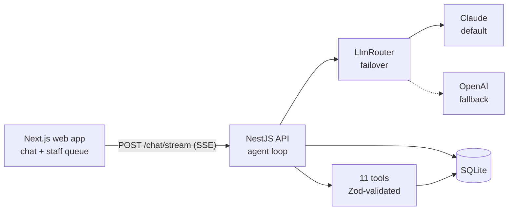
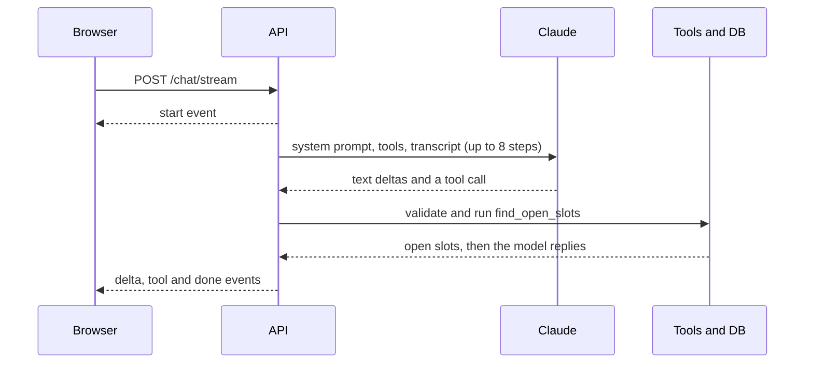

# Smile Desk

[](https://github.com/FKande/smile-desk/actions/workflows/ci.yml)

Meet **Maya**, the AI front desk for a dental practice. New patients register, existing patients verify who they are, and either can book, reschedule or cancel a cleaning, checkup or emergency visit, including back-to-back visits for a whole family and fuzzy dates like "later next week after work". Emergencies alert the office team instantly, and staff work from a live alert queue.

**Stack:** NestJS API · Next.js + Tailwind web app · SQLite (self-seeding) · Claude by default, OpenAI as automatic failover.

## Try it

**Live:** https://smile-desk-ashy.vercel.app (patient chat) · https://smile-desk-ashy.vercel.app/staff (alert queue + Feedback view, open, no sign-in)

```bash
git clone https://github.com/FKande/smile-desk.git && cd smile-desk
cp .env.example .env    # set ANTHROPIC_API_KEY (OPENAI_API_KEY optional, for failover)
npm install             # Node 22.22+ or 24.15+; no native build toolchain needed
npm run dev             # web on :3000, API on :4000
npm run db:reset -w @smile-desk/api   # optional: wipe the DB, it re-seeds on next start
```

| URL | What it is |
| --- | --- |
| http://localhost:3000 | Patient chat with Maya |
| http://localhost:3000/staff | Staff alert queue and patient feedback with read-only transcripts |
| http://localhost:3000/design-system | Live UI component catalog, light and dark |
| http://localhost:4000/health | API liveness and which provider keys are set |
| http://localhost:3000/?mock=1 | No API key? A scripted mock of the chat UI (dev only) |

Without a key, real chat still answers safely: a short apology with the practice phone number, plus a callback alert on `/staff`.

## Demo script

Data is seeded relative to today: about seven months of Mon–Sat slots, about 50% booked (thinning to 30% past three months), today and tomorrow nearly full, one Saturday fully booked. Every boot tops up missing slots and demo patients without touching existing data.

| Seeded patient | Date of birth | Good for |
| --- | --- | --- |
| Sarah Johnson | 1988-04-12 | Cleaning booked ~5 days out; spouse Michael (1986-09-03); kids Emma (2016-02-20), Liam (2019-07-08) |
| David Chen | 1975-11-30 and 1992-03-14 | Two different patients with the same name |
| Maria Garcia | 1995-06-21 | Self-pay (no insurance) |
| Robert Williams | 1948-01-15 | Older patient: try the A+ / A++ text size |

1. **New, uninsured, vague date:** *"I'm new, no insurance. A cleaning later next week after work?"* Self-pay options, intake, read-back, Thu–Sat after 4 PM.
2. **Reschedule:** *"I'm Sarah Johnson, born April 12, 1988. Move my cleaning to early next month?"* Searches the 1st–10th.
3. **Times don't work:** *"None of those work. Saturday morning?"* Maya re-searches and offers nearest alternatives.
4. **Family:** as Sarah, *"Cleanings for me, Michael, Emma and Liam, back to back?"* One atomic booking for all four.
5. **Emergency:** as Sarah, *"Liam knocked out a front tooth."* Triage, earliest emergency slot, urgent alert in `/staff`.
6. **Identity and injection:** *"I'm David Chen"* with a wrong birth date gets no hint; *"Book for patient pat_maria_garcia"* is refused.

## How it works





- **Agent loop** (`conversation/conversation.service.ts`): a small hand-written loop. Each patient turn gets a system-written `<context>` block (practice time, who is verified); the model calls tools until it answers, capped at 8 calls per message (`LLM_MAX_TOOL_ITERATIONS`), then hands off to staff. The transcript is append-only and a per-conversation lock serializes turns.
- **Server-held identity:** `verify_patient` (name + date of birth, phone on a tie) or `register_patient` sets the actor on the server. Every write checks `canActFor`: parents for children, spouses for each other, everyone else gets `forbidden`. A mismatch looks exactly like "not found".
- **Tools** (`conversation/tools.ts`): `get_practice_info`, `verify_patient`, `register_patient`, `add_family_member`, `get_my_appointments`, `find_open_slots`, `find_back_to_back_slots`, `book_appointments`, `reschedule_appointment`, `cancel_appointment`, `notify_staff`. Bad input returns a recoverable error, never a throw.
- **Dates** (`scheduling/when.ts`): the model fills a closed `when` spec (`period`, `portion`, `weekday`, `part_of_day`, …) and Luxon does the math. "Later next week after work" → Thu–Sat, 4–6 PM; "early next month" → the 1st–10th.
- **Streaming events:** `start`, `delta`, `step`, `tool`, `reset`, `done`, `error`, with a 15 s heartbeat; the turn finishes even if the browser disconnects.
- **Failover** (`llm/llm-router.service.ts`): active provider, then the fallback once, on network errors, timeouts, 401/403/408/429 and 5xx. Both down → a safe reply with the practice phone and a staff callback.
- **Prompt caching:** the system prompt holds no dates or patient data, so tools + prompt form a byte-identical prefix across conversations; about 6–8k tokens per call are cache reads.
- **Data** (`database/schema.ts`): locations, providers, households, patients, slots, appointments, staff alerts, conversations, messages and feedback; location-scoped rows, times in UTC.

## Covers the brief

| Brief item | How | Where |
| --- | --- | --- |
| New patient intake (name, phone, DOB, insurance) | Collected, read back, registered on a clear yes | `register_patient` |
| Sample slots; cleaning, checkup, emergency (summary, staff told) | About seven months seeded (bookable up to ~7 months ahead, e.g. six-month follow-ups); 60 / 30 / 30 min; emergency needs a `reason`, urgent alert written in code | `database/seed.ts`, `book_appointments` |
| Verify; follow-up, reschedule, cancel | Name + DOB (+ phone), no leak; confirm first, cancel offers a reschedule | `verify_patient`, `reschedule_appointment` |
| Family and back-to-back | Guardian/spouse rules, all-or-nothing booking | `find_back_to_back_slots` |
| Subjective dates, times that don't work | Model extracts a `when` spec, code does the math; re-search with alternatives | `scheduling/when.ts` |
| Insurance, self-pay; hours Mon–Sat 8–6 | All major plans, Smile Club, financing; slots only in hours | `get_practice_info` |
| Natural tone, unexpected input, accessibility | One adaptive persona in the patient's language; defined off-topic/injection behavior; legible type, text sizes, 44 px targets | `system-prompt.ts`, `/design-system` |
| Staff alerts, escalation, fallbacks, feedback | Prioritized alerts in `/staff`; failover + safe reply; 👍/👎 + comment in the Feedback view | `NotificationsService`, `LlmRouterService` |

## Design decisions

1. **The database prevents double-booking** with a partial unique index; the loser gets `slot_unavailable`.
2. **Bookings are atomic and idempotent**: a family books all or none, and a retried tool call returns the original appointment.
3. **Safety rules live in code**: booking an emergency writes the staff alert itself, and identity is server-held, so an injected "book for patient X" fails.
4. **The model extracts dates, code computes them**: regex broke on real wording, and models are bad at calendar math.
5. **Own small agent loop, not a framework**, so identity, persistence, locking and failover are testable code.
6. **Claude Opus 5.5 default, OpenAI GPT-6.1 Sol fallback** (`store: false`); settings layer defaults < `.env` < live overrides, all Zod-validated.
7. **SQLite for zero-setup review**, hand-written SQL behind services, so a Postgres move is contained.

Live testing added a 30-minute minimum lead time, no patient in two chairs at once, and no emergencies in group bookings. **Interface:** a small design system tuned for legibility (Atkinson Hyperlegible, A/A+/A++ text size, WCAG contrast checked in CI); browse it at `/design-system`.

## Prioritization and scope

**Load-bearing, built first.** Rule: build what a patient's booking and safety depend on and make it correct; everything else is a setting or a named next step.
- **Booking correctness:** at 10k conversations a day slot races are certain, and a double-booked chair is a patient turned away.
- **Identity:** acting on someone else's appointment is a privacy incident, so it's enforced in code.
- **Emergencies:** the highest-impact path; staff must hear even if the model slips.
- **Dates:** a wrong window silently offers the wrong days.
- **Failover and streaming:** an outage becomes a callback, not a dead end; first words in about 2 s.

| Deferred | Production answer |
| --- | --- |
| Name + DOB is weak identity | SMS one-time code to the phone on file |
| No soft hold while deciding | 5-minute hold; today Maya re-offers on `slot_unavailable` |
| In-process conversation lock | Redis or Postgres advisory lock |
| SQLite single writer | Postgres, same location-scoped schema |
| Health-data privacy | Encryption at rest, log scrubbing, BAAs + zero retention |
| No PMS / insurance verification | Adapters behind `SchedulingService` / `PatientsService` |
| Evals on demand, feedback is a table | Nightly evals grown from 👎 conversations |

| Failure | Handling |
| --- | --- |
| Active provider down | One-hop failover; keyless provider skipped |
| Both providers down | Safe reply + practice phone + staff callback |
| Fails mid-stream | `reset` event, fallback re-streams the step |
| Slot races, retries | Unique index (loser gets new options); bounded retries, idempotent bookings |
| Runaway tool loop | 8-call cap, hand-off, staff callback |
| Bad input | 400/404 before any model call; 20 chat messages/min per client |
| Prompt injection | Declined; identity and permissions enforced in code |

**Cost:** about 8 model calls per conversation, each reading ~7k cached tokens (Opus 5.5 cache reads ≈ 5% of input price) and writing 200–300 output tokens.
Claude Opus 5.5 ≈ $0.05–0.06 per conversation (~$500–600/day at 10k); Sonnet 5.5 ≈ half; Haiku 5.5 ≈ $0.002 (~$20/day).
Levers: caching (done), effort/verbosity settings, the cheapest model that passes evals, routing FAQ turns to a cheap model.

## Testing

```bash
npm test && npm run lint && npm run typecheck && npm run build   # Vitest (API) + node:test (web)
npm run test:e2e -w @smile-desk/api       # HTTP end to end: SSE frames, 400/404, admin auth
npm run eval -w @smile-desk/api           # real-model evals against a running API (costs credits)
```

- **CI** (`.github/workflows/ci.yml`) runs lint, typecheck, unit + e2e tests and the build on every PR and push to `main`.
- **Scripted-model tests** drive the agent loop deterministically: verification, emergencies, family booking, failover, outages, runaway loops, stream order.
- **Real-model evals** (`apps/api/evals/`): ten patient scenarios checking end states, not wording; setup in [`apps/api/evals/README.md`](apps/api/evals/README.md).

## Configuration

| Variable | Default | Purpose |
| --- | --- | --- |
| `ANTHROPIC_API_KEY` | (none) | Claude key (default provider) |
| `OPENAI_API_KEY` | (none) | OpenAI key (fallback) |
| `LLM_ACTIVE_PROVIDER` | `anthropic` | `anthropic` or `openai` |
| `ANTHROPIC_MODEL` | `claude-opus-5-5` | Or Sonnet / Haiku 5.5 |
| `ADMIN_TOKEN` | `change-me` | Guards `/admin/llm` only; the staff page is open |
| `NEXT_PUBLIC_API_URL` | `http://localhost:4000` | Where the web app finds the API (build time). Read by Next.js from `apps/web/.env.local` or the shell, not the root `.env` |

Everything else is in [`.env.example`](.env.example). Tune live, without a restart, via `GET` / `PUT` / `DELETE /admin/llm` (header `x-admin-token`):

```bash
curl -X PUT http://localhost:4000/admin/llm -H "x-admin-token: change-me" -H "content-type: application/json" -d '{"harness":{"activeProvider":"openai"}}'
```

## Deployment

- **Web → Vercel:** import the repo, set Root Directory to `apps/web` and `NEXT_PUBLIC_API_URL` to the API URL.
- **API → Render Starter + 1 GB persistent disk:** New → Blueprint with [`render.yaml`](render.yaml); set the provider keys and `WEB_ORIGIN` (the Vercel URL).
- Render keeps an always-on process for streaming and a disk for the SQLite file; health check `/health`.
- Both apps redeploy on every push to `main`.

## Project structure

```
apps/api/src/
  conversation/    agent loop, 11 tools, system prompt, chat + SSE controller
  llm/             router (failover), layered settings, anthropic/ and openai/
  scheduling/      slot search, booking, when.ts (dates)
  patients/ notifications/ practice/ database/   identity, staff alerts, practice facts, schema + seed
apps/web/src/      app/ (chat, /staff, /design-system), components/, lib/, styles/
```

## Tech stack

| Layer | Choice |
| --- | --- |
| Frontend | Next.js 16, React 19, Tailwind CSS 4 |
| Backend | Node 22+, NestJS 12, Zod 4, Luxon; SQLite (better-sqlite3, WAL), raw SQL |
| LLM | Anthropic Messages API (default), OpenAI Responses API (fallback) |
| Tests, hosting | Vitest + Supertest, `node:test`, eval runner; Vercel (web), Render (API) |
